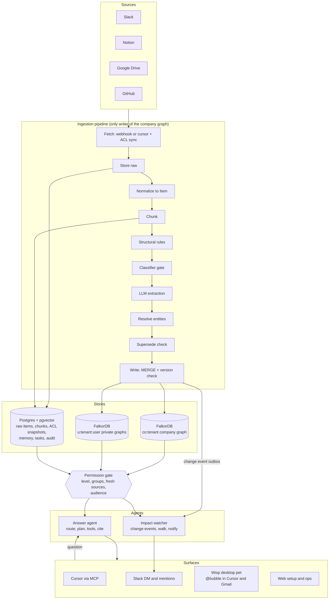

# Weave — Company Brain

Weave is an agent that understands how a company works. It puts people, teams, projects, documents, tickets, chats, and decisions into one permission-aware knowledge graph on **FalkorDB**. Agents answer questions, draft work, and raise alerts across all of it. Every claim is traced to its source.

You can ask from Slack, from Cursor through MCP, or by typing `@bubble` in any draft. The desktop companion, Wisp, finds the fact in the graph and drops it into your Cursor prompt or Gmail draft.

---

## What it does

| Focus | How Weave does it |
| --- | --- |
| **Docs, tickets, and chats in one graph** | Connectors pull Slack, Notion, Google Drive, and GitHub into one company graph per tenant, `co:{tenant}`. A Slack message, Notion page, or GitHub issue becomes an `Item`. Its channel, workspace, or repo becomes a `Source` that holds the permissions. |
| **Who owns what, and who knows what** | `OWNS`, `MADE_BY`, `AUTHORED_BY`, and `MENTIONS` edges connect people to work. `find_owner` returns owners plus experts. Expertise is scored at query time over items the caller can see, so private activity never leaks. |
| **Tracing decisions back to their source** | Every `Decision`, `Commitment`, and `Figure` has `EVIDENCED_BY` edges to the items that state it, with quote, span, and confidence. `trace_decision` walks from the decision to the evidence, the author, and the thread. No evidence, no fact. |
| **Keeping knowledge current** | Webhooks and polling cursors sync changes. A reversed decision adds a `SUPERSEDES` edge and closes the old claim's `valid_to`. It does not overwrite. A change event wakes the impact watcher, which walks dependencies and notifies the owners it affects. |
| **Answers with clear sources** | Every answer is a card: one or two sentences, a quote, author, date, and link for each claim, the path the agent walked, a freshness line, and confidence. Claims without evidence ids are dropped. |

---

## Architecture

A single permission gate stands between every agent and every store. No answer can use a source its caller may not see.



| Component | Responsibility | Built with |
| --- | --- | --- |
| Connectors | Pull content, group membership, and permissions. Backfill first, then incremental. | `app/slack`, `app/notion`, `app/gdrive`, `app/github`, with a cursor per source in Postgres |
| Pipeline workers | Normalize, chunk, extract, resolve, and write. Every step is idempotent and safe to retry. | `app/ingest`, `scripts/run_worker.py` |
| Raw store | Untouched payloads, normalized items, chunks, and ACL snapshots. Every citation points here. | Postgres (Neon) |
| Company graph | Entities, claims, evidence, and projections. One graph per tenant. | **FalkorDB** `co:{tenant}` |
| Private graphs | Each user's personal items and agent knowledge | **FalkorDB** `u:{tenant}:{user}` |
| Memory and state | Episodes, playbooks, conversations, tasks, audit log | Postgres with pgvector |
| Permission gate | One library that turns a principal into Cypher and SQL predicates, applied inside every tool | `agents/gate` |
| MCP server | Exposes the tools over HTTP and turns a bearer token plus surface into a principal | `agents/mcp` |
| Answer agent | Intent routing, a bounded tool loop of at most six calls, citation validation, drafting | `agents/answer` |
| Impact watcher | Consumes change events, walks dependencies, notifies owners | `agents/watcher` |
| Wisp | Desktop companion. Watches for `@bubble` in Cursor and Gmail and pastes the answer into the draft. | `cursor-wisp/desktop`, `cursor-wisp/gmail` |

### Design principles

1. **Raw first, graph second.** Every fetched item is stored untouched. Graph nodes point to it, so facts can be re-extracted, cited, and retracted.
2. **Fixed core ontology.** Predictable node and edge types keep multi-hop queries and permission checks reliable. They are frozen in `shared/schema.py`, and no query spells a label by hand.
3. **No evidence, no fact.** A claim without an `EVIDENCED_BY` edge is never shown.
4. **Sources write the graph, agents do not.** Agents use read-only queries (`ro_query`). A conversation can never turn a private fact into shared knowledge.
5. **Supersede, never overwrite.** History stays queryable. "Current" means `status = 'active'`.
6. **Permissions are enforced in code at query time.** The LLM never decides who sees what.
7. **Memory points at the graph.** Agent memory stores node ids, not copies of facts, so it cannot go stale.
8. **Fixed, vetted tools.** Agents call tools, not free-form Cypher. Each tool has the permission filter built in.

---

## How we use FalkorDB

FalkorDB is the brain itself. Everything the agent knows about the company is a node or an edge in it.

- **One graph per tenant** (`co:{tenant}`) and one private graph per user (`u:{tenant}:{user}`) give hard isolation by graph name.
- **Permission-aware Cypher.** `agents/gate/visible.py` builds the visibility rule as a Cypher expression over each item's `acl_groups`, `min_level`, `deleted` flag, and source freshness. That filter runs inside every query, before ranking and `LIMIT`. FalkorDB has no `EXISTS { }` subqueries and rejects pattern comprehensions inside `WHERE`. The claim rule is written instead as `WITH ..., [visible evidence] AS ev WHERE size(ev) > 0`.
- **Provenance.** Each claim links through `EVIDENCED_BY` to `Item`, then `IN_SOURCE` to `Source`. One traversal returns the fact, the quote, the author, and the link.
- **Time and supersession.** The `SUPERSEDES` chain plus `valid_from` and `valid_to` answer both "what is current" and "what was true on date X".
- **Cross-team impact.** `NEEDS`, `DEPENDS_ON`, and `BLOCKED_BY` link Sales deals to Engineering projects and commitments. `get_dependencies` and `impact_of` walk up to 3 hops, one gated hop per query. A hidden edge is counted, never named.
- **Idempotent ingestion.** Writes use `MERGE` inside `UNWIND` batches, with deterministic ids and a version check. A retry changes nothing, and an older version never overwrites a newer one.

### Graph data model

The full model is in [docs/graph-model.md](docs/graph-model.md): every node's properties, every edge's allowed endpoints, ids, ACL format, indexes, validator rules, and example Cypher. In summary, there are 13 core node types in 4 families.

| Family | Nodes |
| --- | --- |
| Org | `Person` (email, level 0–3, dept, Slack, GitHub, and Notion identities), `Team`, `Department` |
| Work | `Project`, `Topic`, `Customer`, `Deal` |
| Claims | `Decision`, `Commitment`, `Figure`, each with `status`, `valid_from`, `valid_to`, `confidence`, `last_verified_at` |
| Evidence | `Item` (a message, page, or issue, with `acl_groups` and `min_level`), `Source` (a channel, workspace, or repo, with authority and cascade policy), `Projection` (a sanitized summary for a wider audience) |

Key edges:

- **Org:** `MEMBER_OF`, `PART_OF`, `REPORTS_TO`
- **Ownership and expertise:** `OWNS`, `MADE_BY`, `KNOWS_ABOUT`
- **Claims:** `ABOUT`, `SUPERSEDES`, `EVIDENCED_BY` (quote, span, confidence)
- **Cross-department bridges:** `NEEDS` (Deal → Project), `DEPENDS_ON` (Commitment → Decision, Project, or Commitment), `BLOCKED_BY`, `FOR`, `PROMISED_TO`
- **Structure:** `IN_SOURCE`, `AUTHORED_BY`, `MENTIONS`, `LINKS_TO`, `REPLIES_TO`, `SUMMARIZES`

---

## Ingestion pipeline

| # | Stage | What it does |
| --- | --- | --- |
| 1 | Fetch | Webhook where the tool offers one (Slack is verified, deduplicated, and acknowledged within 3 s), otherwise a polling cursor. ACLs and group membership are synced too. |
| 2 | Store raw | Keyed by system, external id, and `content_hash`. An unchanged hash ends the run. |
| 3 | Normalize | One `Item` shape for every source |
| 4 | Chunk | A Slack thread, Notion and Drive sections, a GitHub issue with its comments. Chunks get full-text and optional vector indexes. |
| 5 | Structural rules | Author, @mentions, links, PR-closes-issue. These edges get confidence 1. |
| 6 | Classifier gate | Skips chunks with no decision, commitment, figure, or request |
| 7 | LLM extraction | Structured JSON against the ontology, with quote, span, and confidence for each candidate |
| 8 | Resolve | People through an identity map keyed by email. Topics and projects through aliases, then a vector match, then an LLM check. |
| 9 | Supersede | Compares new claims with active ones: duplicate, supersedes, contradicts, or coexists. A lower-authority source (chat 1, tracker 2, document 3) cannot supersede a higher one. |
| 10 | Write | Idempotent `MERGE` into FalkorDB, then a change event in the Postgres outbox |

---

## Permission gate

- **Principal.** A token resolves to tenant, user, level (0 intern to 3 director), department, and groups. Groups come from Slack channels, GitHub repo access, Drive sharing, and Notion membership.
- **Audience rule.** Private surfaces (Cursor, a DM, the pet) answer as the asker. A shared Slack channel answers as the channel principal: the lowest member level plus the channel's own groups. If that principal sees too little, the bot offers the full answer by DM.
- **Source rule.** An item is visible when its groups overlap the caller's groups (or it is org-wide) and the caller's level is at least its `min_level`.
- **Claim rule.** A claim is visible when at least one of its evidence items is visible. Only visible evidence is returned, counted, or ranked, so aggregates cannot leak.
- **Projections.** Management decisions reach lower levels as approved summaries, with the source shown as restricted: no quote and no link.
- **Freshness.** If a source's last good ACL sync is older than the cutoff, that source is excluded, so a stalled sync hides data instead of leaking it.
- **Postgres row-level security** (`migrations/007_rls.sql`) isolates tenants in every table.

---

## Agents and tools

Three agents share one set of vetted tools:

- The **ingestion** pipeline writes the graph.
- The **answer agent** reads the graph and drafts.
- The **impact watcher** reacts to change.

| Tool | What it returns |
| --- | --- |
| `search_context` | Hybrid keyword and vector hits over visible chunks, expanded one hop to claims and subjects |
| `get_decision` | The active decision on a topic, optionally as of a date, with its supersession chain and evidence |
| `trace_decision` | The full path: decision, evidence items, authors, threads |
| `find_owner` | Owners, plus the top experts scored over visible items |
| `get_figures` | Latest figures with the as-of date, source, and history |
| `get_dependencies` | Neighbours over `NEEDS`, `DEPENDS_ON`, and `BLOCKED_BY`, labelled by department |
| `impact_of` | Commitments, deals, and projects affected by a change, with owners |
| `dept_rollup` | Counts of open cross-team requests, blocks, and at-risk items |
| `draft_email` | A draft with a footnoted evidence list. Customer email stays draft-only. |
| `notify_owner` | A proposed Slack notice. You propose it, then confirm. |
| `remember` / `recall_memory` | Episodes and notes, keyed by tenant, user, and agent. Ids are re-checked by the gate on recall. |

The answer agent classifies intent (lookup, provenance, ownership, impact, or draft), exposes only the tools that intent needs, and follows a playbook per role. Playbooks are versioned in Postgres. Each tool returns node ids, so the next call starts from ids rather than text. A citation validator drops any claim without an evidence id.

### Agent memory

| Kind | Holds | Lives in |
| --- | --- | --- |
| Episodic | Question, tools called, node ids, outcome, feedback | Postgres |
| Semantic | Stable facts about the user, as links to graph ids | Private FalkorDB graph |
| Procedural | Playbooks per role and intent | Postgres, versioned |
| Conversation | Each thread, turn by turn | Postgres |

---

## Surfaces

- **Cursor (MCP).** Point Cursor at `https://<mcp-host>/mcp` with `Authorization: Bearer <token>`. Cursor's model sees the tools through `tools/list`.
- **Slack.** DMs answer as the mapped person. Channel mentions answer as the channel principal.
- **Wisp and `@bubble`.** The desktop pet watches the Cursor prompt and Gmail drafts. Type `@bubble` where you need a fact, for example `the profit is @bubble it has grown from @bubble`. Each `@bubble` becomes its own question, the card shows the answer and citation, and Accept replaces only that token. `@bubble can you draft email about the budget and sales` becomes a drafted email built from graph facts. See [docs/wisp.md](docs/wisp.md).
- **Web.** `GET /` is the setup page for connecting sources and minting a viewer token. `GET /ops` shows sync age, ingestion lag, queue depth, and p95 latency.

---

## Keeping knowledge current

| Event | Detection | Effect |
| --- | --- | --- |
| Item created or edited | Webhook or cursor, `content_hash` differs | New version, re-extraction, supersession check |
| Decision reversed | A new decision on the same subject is judged "supersedes" | Old claim becomes `superseded` with `valid_to` set; `SUPERSEDES` edge added; change event emitted |
| Item deleted at source | Delete event or reconcile pass | Evidence removed. A fact left with no evidence is retracted. |
| Permission changed | ACL re-sync, plus Slack membership and privacy events | Applies from the next query. Visibility is checked at read time, so no data moves. |
| Sync stalls | Last good sync is older than the cutoff | Source excluded until it recovers |
| Fact repeated | A newer item restates it | `last_verified_at` moves forward and confidence rises |

---

## Demo

The fake company is tenant `acme` on graph `co:acme`. The live demo tenant is `real`.

1. **Cursor recommends the agreed API (flow 1).** "Which SSO provider should I use?" `get_decision` returns Provider B, cites Dev's `#eng-sso` message, and notes that it replaced Provider A. Priya gets the same decision, citing only the roadmap.
2. **Sales email reflects engineering status (flow 2).** Priya asks for an Acme status update. Each sentence of the draft is footnoted to evidence she can see.
3. **Reversal alerts the people it hurts (flow 3).** A change event becomes a gated notice: Priya's commitment "SSO live for Acme by Nov 15" is at risk.
4. **Slack mention and DM.** The answer is shaped for the audience: the channel principal in a channel, the person in a DM.
5. **`@bubble` in Cursor.** Type `rn we are using the open ai api key can you change it to @bubble`. Accept fills in the demo key `sk-weave-demo-4k7Q`, which is fake.
6. **`@bubble` in Gmail.** Type `hey, as per discussed the profit is @bubble it has grown from @bubble`. Accept fills in `$2.4M` and `$1.8M`. Then type `@bubble can you draft email about the budget and sales`, and Accept writes a draft with the budget ($900K) and sales ($3.1M). All of these figures are fake demo data.

Seed the demo facts with `python -m scripts.seed_demo_api_key` and `python -m scripts.seed_demo_email`. Seed the playbooks with `python -m scripts.seed_playbooks`.

---

## Setup

Use Python 3.12, then install from this directory:

```bash
pip install -e ".[dev]"
```

Copy `.env.example` to `.env` and put keys only there; it is gitignored. Fill these values:

- `GROQ_API_KEY`
- `DATABASE_URL` and `DATABASE_URL_UNPOOLED`
- Either `FALKORDB_URL`, or `FALKORDB_HOST` and `FALKORDB_PORT`
- The `SLACK_*` values
- `WEAVE_TENANT`
- `OPS_TOKEN`, if you want the ops page

On Neon, `DATABASE_URL` is the pooled endpoint and `DATABASE_URL_UNPOOLED` is the direct endpoint. Migrations and the watcher outbox use the direct endpoint.

Apply every file in `migrations/` on the direct connection, including `007_rls.sql` (row-level security) and `008_connection_secret.sql` (connection secrets).

Run the stack:

```bash
python -m agents.mcp --host 127.0.0.1 --port 8765   # answer agent + MCP
python scripts/run_worker.py                         # ingestion + impact watcher
uvicorn app.main:app --port 8000                     # setup page, Slack and GitHub webhooks
```

### Docker Compose

`docker compose up` starts these services:

- `api` on port 8765
- `worker`
- `web` on port 8080
- `falkordb`
- `postgres`

When you use the Compose databases, set `FALKORDB_HOST=falkordb` and use `postgres` as the host in `DATABASE_URL`.

### Deployment

- **AWS:** see [docs/deployment.md](docs/deployment.md). The tasks were stopped on 18 October 2026. The images and saved parameters remain.
- **Public hostnames:** [deploy/README.md](deploy/README.md) documents the cloudflared hostnames for the web UI and MCP. Get tokens from `python -m scripts.issue_demo_tokens`.

### LLM

`config/weave.yaml` sets `answer.llm.provider: groq` with model `openai/gpt-oss-120b` and a limit of 30 requests per minute. `provider: none` is the rule-based path, which the tests and the load test use.

---

## Tests and load

Run the full offline suite:

```bash
python -m pytest tests/ -q
```

Run the gate, isolation, Wisp, and `@bubble` checks:

```bash
python -m pytest tests/test_gate.py tests/test_rls.py tests/test_wisp_cue.py tests/test_bubble_pet.py tests/test_wisp_mail.py -q
```

Run the load test with 50 simulated users. It needs `provider: none` on the API process:

```bash
python -m scripts.load_answer --users 50 --url http://127.0.0.1:8765 --as sam
```

The visibility matrix is the first test table: one case per person and source. Added cases cover channel audience, privacy flips, revocation, stale snapshots, source authority, Slack retries, and a check that no agent tool can write the graph.
