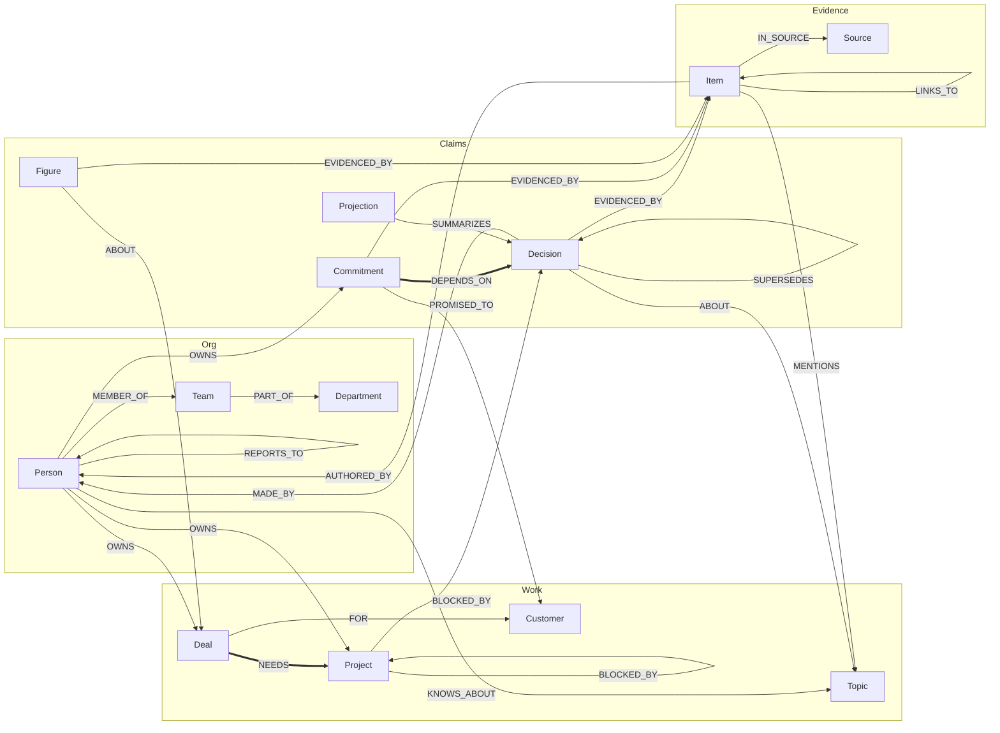
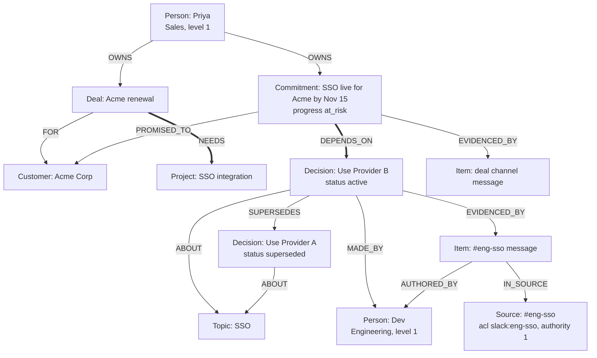

# Weave graph data model (FalkorDB)

This is the contract for the FalkorDB graphs that hold Weave's company knowledge. The code version is [`shared/schema.py`](../shared/schema.py), and queries import labels, edge types, and properties from it instead of spelling them by hand. [`shared/validate.py`](../shared/validate.py) checks a graph against these rules. [`shared/indexes.py`](../shared/indexes.py) creates the indexes.

## Graphs

| Graph | Name | Holds | Who writes it |
| --- | --- | --- | --- |
| Company graph | `co:{tenant}` | People, org units, work, claims, evidence, and projections for one company | Only the ingestion pipeline |
| Private graph | `u:{tenant}:{user}` | One person's personal items and the agent's semantic memory about them | The memory consolidation job, for that user only |

Each tenant has its own graph name, so a query against `co:acme` can never see `co:real`. Agents open the company graph read-only and query it with `ro_query`. A test enumerates every registered tool and fails if any of them can write to the graph.

Every node carries `tenant_id`, and every id starts with `{tenant}:`.

## Overview

The model has 13 contract node types in four families. Claims sit at the bottom: every claim points at the items that state it, and every item points at the source that owns its permissions.



The thick edges, `NEEDS` and `DEPENDS_ON`, are the bridges between Sales and Engineering.

## Labels

Each node has exactly one **contract label**, which is what agents query. Ingestion can add a **source-specific label** next to it:

| Contract label | Source-specific label | Example |
| --- | --- | --- |
| `Item` | `Message` | A Slack message or Gmail message |
| `Item` | `Document` | A Notion page or Drive file |
| `Item` | `Issue` | A GitHub issue or PR |
| `Source` | `Conversation` | A Slack channel |
| `Source` | `Repository` | A GitHub repo |
| `Source` | `Teamspace` | A Notion teamspace or Drive folder |

So a Slack message is `(:Message:Item)`, and a Slack channel is `(:Conversation:Source)`.

Ingestion also writes a few bookkeeping nodes that sit outside the contract and that agents never read: `Tenant`, `Connection`, and `GithubDelivery`, joined by `HAS_CONVERSATION` and `HAS_SOURCE`.

## Node types

**Req** means the property is required (`REQUIRED_PROPS`), and the validator rejects a node without it. Timestamps are UTC ISO-8601 strings at second precision, for example `2026-10-12T09:30:00+00:00`, so comparing them as strings matches time order. Date-only values are `YYYY-MM-DD`.

### Org

#### `Person`

An employee or contact. People are the subjects of ownership, expertise, authorship, and permissions.

| Property | Type | Req | Notes |
| --- | --- | --- | --- |
| `id` | string | ✓ | `{tenant}:person:{email}` (lowercased) |
| `tenant_id` | string | ✓ | |
| `name` | string | ✓ | |
| `email` | string | ✓ | Identity key across tools |
| `level` | int | ✓* | `0` intern, `1` individual contributor, `2` manager, `3` director |
| `dept` | string | ✓* | Department name, for example `Sales` or `Engineering` |
| `slack_id` | string | | Slack user id |
| `github_login` | string | | GitHub login |
| `notion_user` | string | | Notion user id |
| `provisional` | bool | | `true` until a second sighting confirms the person |

\* `level` and `dept` are required unless `provisional = true`.

#### `Team`, `Department`

Org units from the seeded org chart.

| Property | Type | Req | Notes |
| --- | --- | --- | --- |
| `id` | string | ✓ | `{tenant}:team:{slug}` or `{tenant}:department:{slug}` |
| `name` | string | ✓ | |
| `kind` | string | ✓ | For example `team` or `department` |

### Work

#### `Project`

A feature, epic, repo, or initiative.

| Property | Type | Req | Notes |
| --- | --- | --- | --- |
| `id` | string | ✓ | `{tenant}:project:{slug}` |
| `name` | string | ✓ | Full-text indexed |
| `status` | string | ✓ | Project state |
| `aliases` | list<string> | ✓ | Other names used in sources |

#### `Topic`

A technology, API, library, or concept, for example "SSO" or "OpenAI API key".

| Property | Type | Req | Notes |
| --- | --- | --- | --- |
| `id` | string | ✓ | `{tenant}:topic:{slug}` |
| `name` | string | ✓ | Full-text indexed |
| `aliases` | list<string> | ✓ | For example `["single sign-on"]` |

#### `Customer`

| Property | Type | Req | Notes |
| --- | --- | --- | --- |
| `id` | string | ✓ | `{tenant}:customer:{slug}` |
| `name` | string | ✓ | Full-text indexed |

#### `Deal`

| Property | Type | Req | Notes |
| --- | --- | --- | --- |
| `id` | string | ✓ | `{tenant}:deal:{slug}` |
| `name` | string | ✓ | |
| `stage` | string | ✓ | Sales stage |
| `renewal_date` | date | ✓ | `YYYY-MM-DD` |

### Claims

`Decision`, `Commitment`, and `Figure` are **claims**: facts extracted from sources. They share one lifecycle.

| Property | Type | Req | Notes |
| --- | --- | --- | --- |
| `id` | string | ✓ | `{tenant}:{label}:{sha256(first_evidence_item_id + normalized statement)[:16]}` |
| `status` | enum | ✓ | `active`, `superseded`, `retracted`. "Current" always means `status = 'active'`. |
| `valid_from` | timestamp | ✓ | When the claim became true |
| `valid_to` | timestamp | | Must be empty while active, and must be set once superseded |
| `confidence` | float | ✓ | Between 0 and 1. Answers mark low values as "likely". |
| `last_verified_at` | timestamp | ✓ | Moves forward when a newer item restates the claim |
| `extractor_version` | string | ✓ | Which extractor produced the claim, so it can be re-extracted |

Each claim type adds its own properties:

| Label | Extra properties (all required) | Meaning |
| --- | --- | --- |
| `Decision` | `statement` | A choice that was made, for example "Use Provider B for SSO." |
| `Commitment` | `statement`, `due` (date), `progress` (`open`, `at_risk`, `done`) | A promise with a date. Delivery state is `progress`, never `status`. |
| `Figure` | `name`, `value`, `unit`, `as_of` (timestamp) | A number about something, for example profit $2.4M as of Q3 |

**Rules for every claim:**
- It must have at least one `EVIDENCED_BY` edge. No evidence, no fact.
- A claim is visible only when at least one of its evidence items is visible to the caller.
- A reversal never overwrites anything. Ingestion writes the new claim, adds `(new)-[:SUPERSEDES]->(old)`, sets the old claim to `status = 'superseded'` and sets its `valid_to`, then emits a change event.

#### `Projection`

A sanitized summary of a claim, cascaded to a wider audience. This is how an intern learns about a management decision without seeing the leadership channel.

| Property | Type | Req | Notes |
| --- | --- | --- | --- |
| `id` | string | ✓ | `{tenant}:projection:{sha256(origin_id + sorted audience)[:16]}` |
| `summary` | string | ✓ | Two sentences, with confidential figures and names redacted |
| `audience` | list<acl group> | ✓ | Groups that may see it |
| `level_floor` | int | ✓ | `0` to `3`. The minimum caller level. |
| `origin_id` | string | ✓ | The claim it summarizes |
| `status` | enum | ✓ | `draft` or `approved`. Only `approved` is shown. |

A projection has exactly one `SUMMARIZES` edge, and it points at `origin_id`.

### Evidence

#### `Item`

One normalized source object: a Slack message, Gmail message, Notion page, Drive file, or GitHub issue or PR. Every citation points at an item.

| Property | Type | Req | Notes |
| --- | --- | --- | --- |
| `id` | string | ✓ | See [Ids](#ids) |
| `source` | string | ✓ | System: `slack`, `notion`, `gdrive`, `github`, `gmail`, `gcal`, `hubspot` |
| `external_id` | string | ✓ | The id in the source system |
| `object_type` | string | ✓ | `message`, `document`, `issue`, … |
| `occurred_at` | timestamp | ✓ | When it was written |
| `source_url` | string | ✓ | Deep link shown in citations |
| `content_hash` | string | ✓ | sha256 of the content. An unchanged hash skips re-processing. |
| `deleted` | bool | ✓ | Tombstone. Deleted items are never shown. |
| `acl_groups` | list<acl group> | ✓ | Who may see it, copied from its source |
| `min_level` | int | ✓ | `0` to `3`. Range indexed. |
| `excerpt` | string | | Text used as the citation snippet |
| `title` | string | | Page or issue title |
| `version` | string | | Source version. An older version never overwrites a newer one. |
| `edited_at` | timestamp | | Last edit at the source |
| `raw_id` | string | | Pointer to the untouched payload in Postgres |
| `placeholder` | bool | | `true` for a thread parent seen only through a reply |

Rules: an item has exactly one `IN_SOURCE` edge. When the author's email is known, it has exactly one `AUTHORED_BY` edge.

#### `Source`

A container that owns permissions: a Slack channel, GitHub repo, Notion teamspace, or Drive folder.

| Property | Type | Req | Notes |
| --- | --- | --- | --- |
| `id` | string | ✓ | For example `{tenant}:slack:conversation:{team}:{channel}` |
| `source` | string | ✓ | System |
| `external_id` | string | ✓ | |
| `name` | string | ✓ | Channel or repo name, shown in citations |
| `acl_groups` | list<acl group> | ✓ | |
| `min_level` | int | ✓ | `0` to `3` |
| `cascade_policy` | enum | ✓ | `broadcast` (projections are written automatically) or `manual` (a manager approves them) |
| `authority` | int | ✓ | `3` formal documents (Notion, Drive), `2` trackers (GitHub), `1` chat (Slack) |

## Edge types

The validator rejects any edge whose endpoints are not listed here (`EDGE_ENDPOINTS`).

### Org and expertise

| Edge | From | To | Properties | Use |
| --- | --- | --- | --- | --- |
| `MEMBER_OF` | Person | Team | | Org chart |
| `PART_OF` | Team | Department | | Org chart |
| `REPORTS_TO` | Person | Person | | Managers at level 2 and above inherit the groups of everyone below them |
| `OWNS` | Person | Project, Commitment, Topic, Deal, Customer | | Who owns what. Also used to decide who gets notified. |
| `KNOWS_ABOUT` | Person | Topic, Project | `score` (required) | Who knows what. The stored score covers all items, so `find_owner` rescores over visible items at query time. |

### Claims

| Edge | From | To | Properties | Use |
| --- | --- | --- | --- | --- |
| `ABOUT` | Decision, Figure | Topic, Project, Deal | | What the claim is about |
| `MADE_BY` | Decision | Person | | Who decided |
| `SUPERSEDES` | Decision, Figure, Commitment | Decision, Figure, Commitment | | The history chain. The target must be `superseded` with `valid_to` set, and a claim cannot supersede itself. |
| `EVIDENCED_BY` | Decision, Commitment, Figure | Item | `quote`, `span` `[start, end]`, `confidence` (all required) | Provenance for every fact |
| `SUMMARIZES` | Projection | Decision, Commitment, Figure | | Cascaded summary |

### Cross-department dependencies

Each of these edges must carry `evidence_ids`, a non-empty list of `Item` ids that justify the link. A walk counts an edge only when the caller can see at least one of those items.

| Edge | From | To | Use |
| --- | --- | --- | --- |
| `NEEDS` | Deal | Project | **Bridge**: Sales needs something Engineering builds |
| `DEPENDS_ON` | Commitment | Decision, Project, Commitment | **Bridge**: a promise rests on a decision or on other work |
| `BLOCKED_BY` | Project | Project, Decision | Delivery risk |

Two related edges have no evidence rule:

| Edge | From | To | Use |
| --- | --- | --- | --- |
| `FOR` | Deal | Customer | Who the deal is for |
| `PROMISED_TO` | Commitment | Customer | Who the promise was made to |

### Structure (from the rules step, confidence 1)

| Edge | From | To | Use |
| --- | --- | --- | --- |
| `IN_SOURCE` | Item | Source | Where an item lives and whose permissions apply. Exactly one per item. |
| `AUTHORED_BY` | Item | Person | Author |
| `MENTIONS` | Item | Person, Topic, Project, Customer | @mentions and named subjects |
| `LINKS_TO` | Item | Item | A URL from one item to another |
| `REPLIES_TO` | Item | Item | A thread reply to its parent |

## Ids

Ids are deterministic, so a retried write merges into the same node instead of creating a duplicate ([`shared/ids.py`](../shared/ids.py)).

| Node | Format | Example |
| --- | --- | --- |
| Person | `{tenant}:person:{email}` | `acme:person:priya@acme.com` |
| Entity | `{tenant}:{label}:{slug(name)}` | `acme:topic:sso` |
| Claim | `{tenant}:{label}:{sha256(evidence + statement)[:16]}` | `acme:decision:3f9a1c0e7b2d4a55` |
| Projection | `{tenant}:projection:{sha256(origin + audience)[:16]}` | |
| Slack message | `{tenant}:slack:message:{channel}:{ts}` | `real:slack:message:C0C90JZ4YMP:1791921228.170589` |
| Slack channel | `{tenant}:slack:conversation:{team}:{channel}` | `real:slack:conversation:T0C8H9PPXU7:C0C90JZ4YMP` |
| Notion or Drive doc | `{tenant}:{source}:document:{workspace}:{external_id}` | |
| GitHub issue | `{tenant}:github:issue:{repo}:{number}` | `real:github:issue:yuv008/portfolio:1` |
| Gmail message | `{tenant}:gmail:message:{mailbox}:{message_id}` | |

## Permissions in the graph

ACL groups are strings in the form `{system}:{container}` ([`shared/acl.py`](../shared/acl.py)):

| Group | Meaning |
| --- | --- |
| `slack:C0123ABC` | Members of a Slack channel |
| `github:org/repo` | People with access to a repo |
| `notion:{teamspace_or_page}` | Notion members |
| `gdrive:{folder_id}` | People a Drive folder is shared with |
| `org:all` | Everyone in the company |

A caller is a principal with a `level`, a set of `groups`, and the set of `fresh` source groups (sources whose last good ACL sync is within the cutoff). These travel to every query as `$gate_level`, `$gate_groups`, and `$gate_fresh`. Each tool builds its `WHERE` clause from [`agents/gate/visible.py`](../agents/gate/visible.py):

**Item rule.** The item is not deleted, its level is low enough, every one of its groups is fresh or org-wide, and at least one of its groups belongs to the caller:

```cypher
coalesce(i.deleted, false) = false
AND i.min_level <= $gate_level
AND all(g IN i.acl_groups WHERE g = 'org:all' OR g IN $gate_fresh)
AND any(g IN i.acl_groups WHERE g IN $gate_groups)
```

**Claim rule.** A claim is kept only if it has visible evidence. FalkorDB has no `EXISTS { }` subqueries and rejects pattern comprehensions inside `WHERE`, so the rule is a `WITH` step that binds the visible evidence and filters on its size:

```cypher
MATCH (d:Decision)-[:ABOUT]->(t:Topic {id: $topic})
WHERE d.status = 'active'
WITH d, [(d)-[:EVIDENCED_BY]->(i:Item) WHERE <item rule on i> | i] AS gate_evidence
WHERE size(gate_evidence) > 0
RETURN d, gate_evidence
```

**Edge rule.** A dependency edge is kept only if one of its `evidence_ids` items is visible:

```cypher
MATCH (a {id: nid})-[r:NEEDS|DEPENDS_ON|BLOCKED_BY]->(b)
OPTIONAL MATCH (gate_ei:Item)
WHERE gate_ei.id IN coalesce(r.evidence_ids, []) AND <item rule on gate_ei>
WITH a, b, r, collect(gate_ei) AS gate_edge_evidence
WHERE size(gate_edge_evidence) > 0
```

**Projection rule.** A projection is shown only when it is `approved`, the caller's level meets `level_floor`, and one of its `audience` groups belongs to the caller. The source is named as restricted: no quote and no link.

Because the filter runs inside the query, before ranking and `LIMIT`, hidden items are never returned, counted, or used for scoring.

## Indexes

[`shared/indexes.py`](../shared/indexes.py) creates them, and running it twice is safe.

| Kind | Label | Property |
| --- | --- | --- |
| Range | every contract label | `id` |
| Range | `Decision`, `Commitment`, `Figure`, `Projection` | `status` |
| Range | `Item` | `min_level` |
| Range | `Person` | `email` |
| Full-text (`db.idx.fulltext.createNodeIndex`) | `Topic`, `Project`, `Customer` | `name`, used to match subjects in a question |
| Range (ingestion) | `Message`, `Document` | `id`, `tenant_id` |
| Range (ingestion) | `Issue`, `Tenant`, `Conversation`, `Connection`, `GithubDelivery` | `id` |

Vector search over text chunks runs in Postgres (`chunk` table, pgvector plus a generated `tsvector`). Each hit is then checked against its FalkorDB `Item` with the item rule above, so the graph decides what is shown.

## Writes

- **Only ingestion writes** `co:{tenant}`. Agents use `ro_query`.
- **`MERGE` on deterministic ids**, batched inside `UNWIND` (100 to 500 rows). A retry changes nothing.
- **Version check.** An update applies only when the incoming `version` is newer. An equal version re-merges edges without changing properties. An older version does nothing.
- **Tombstones.** An item deleted at its source gets `deleted = true`. A claim left with no evidence becomes `retracted`.
- **Change events** go to a Postgres outbox right after the graph write, keyed by fact id, and the impact watcher consumes them.

## Validator invariants

`python -m scripts.validate_graph` exports the graph and checks every rule below:

1. Each node has exactly one contract label, its id starts with `{tenant}:`, and no id is duplicated.
2. `tenant_id` matches the graph's tenant.
3. Required properties are present, and timestamps use the contract format.
4. Claims: `status` is one of `active`, `superseded`, `retracted`. `confidence` is between 0 and 1. An active claim has no `valid_to`.
5. Commitments: `progress` is one of `open`, `at_risk`, `done`.
6. Projections: `status` is `draft` or `approved`, `audience` holds valid ACL groups, and `level_floor` is between 0 and 3.
7. Items and sources: `acl_groups` are valid, and `min_level` is between 0 and 3. Sources also have a valid `cascade_policy`.
8. Non-provisional people have a `level` between 0 and 3 and a non-empty `dept`.
9. Every edge type is in the contract, and its endpoints are allowed.
10. Required edge properties are present: `EVIDENCED_BY` has `quote`, `span`, and `confidence`. `KNOWS_ABOUT` has `score`. Dependency edges have `evidence_ids`.
11. `evidence_ids` is a non-empty list of real `Item` ids.
12. Every claim has at least one `EVIDENCED_BY` edge.
13. Every item has exactly one `IN_SOURCE` edge, plus exactly one `AUTHORED_BY` edge when its author's email is known.
14. A projection's only `SUMMARIZES` target is its `origin_id`.
15. A `SUPERSEDES` target is `superseded`, has `valid_to` set, and is not the same node.

## Worked example: the SSO story

The Acme demo (`co:acme`) shows the whole model in one subgraph:



- **"Which SSO provider should I use?"** `get_decision` matches `Topic: SSO`, keeps the `active` decision with visible evidence, and returns Provider B. It cites `m1` and notes that Provider B replaced Provider A through `SUPERSEDES`.
- **"What breaks if we change SSO?"** `impact_of` walks `DEPENDS_ON` and `NEEDS` back from the decision to Priya's commitment and the Acme deal. It returns their owner through `OWNS`. Each hop is gated by the edge's `evidence_ids`.
- **Priya cannot see `#eng-sso`.** She still gets the decision through an approved `Projection` or the GitHub issue, but `m1` is never quoted to her.

## Cypher queries the product depends on

These are the queries the product actually runs, copied from the code with the schema constants written out. Agent queries go through `ro_query`; only the ingestion rows at the end write.

Two shorthands are used below:

- `VISIBLE(i)` stands for the [item rule](#permissions-in-the-graph), expanded in place for the alias `i`.
- `KEEP_VISIBLE(d)` stands for the claim rule's `WITH` step:

  ```cypher
  WITH d, [(d)-[:EVIDENCED_BY]->(gate_i:Item) WHERE VISIBLE(gate_i) | gate_i] AS gate_evidence
  WHERE size(gate_evidence) > 0
  ```

Lookups by id use `UNWIND $ids` so that one round trip covers a whole batch. Each one hits the range index on `id`.

### 1. Who is asking: the principal

[`agents/gate/stores.py`](../agents/gate/stores.py) builds the caller's level, department, and subordinates. Managers at level 2 and above inherit the ACL groups of everyone who reports to them, up to 6 levels deep:

```cypher
MATCH (p:Person {id: $id})
OPTIONAL MATCH (s:Person)-[:REPORTS_TO*1..6]->(p)
RETURN p.level, p.dept, collect(DISTINCT s.id)
```

In a shared Slack channel the principal is the channel audience. Its level is the lowest level among the members:

```cypher
MATCH (p:Person) WHERE p.id IN $ids
RETURN p.id, p.level
```

### 2. What the question is about: subject matching

[`agents/answer/subjects.py`](../agents/answer/subjects.py) loads every subject name and alias once per question, then matches them in Python (see [Graph algorithms](#graph-algorithms)):

```cypher
MATCH (n)
WHERE (n:Topic OR n:Project OR n:Customer OR n:Deal OR n:Person)
  AND coalesce(n.provisional, false) = false
RETURN n.id, n.name, coalesce(n.aliases, []), labels(n)
```

When a tool argument names a subject, [`agents/tools/subjects.py`](../agents/tools/subjects.py) resolves it by id, by name, or by alias:

```cypher
MATCH (n)
WHERE (n:Topic OR n:Project OR n:Customer OR n:Deal)
  AND coalesce(n.provisional, false) = false
  AND (n.id = $ref
       OR toLower(n.name) = $lower
       OR any(a IN coalesce(n.aliases, []) WHERE toLower(a) = $lower))
RETURN n.id, n.name, labels(n)
```

### 3. `get_decision`: the current decision, or the one in force on a date

Find candidate decisions about the subject. The current decision:

```cypher
MATCH (d:Decision)-[:ABOUT]->(s {id: $subject})
WHERE d.status = 'active'
RETURN d.id
```

The decision in force at `$as_of` (time travel):

```cypher
MATCH (d:Decision)-[:ABOUT]->(s {id: $subject})
WHERE d.status <> 'retracted'
  AND d.valid_from <= $as_of
  AND (d.valid_to IS NULL OR d.valid_to > $as_of)
RETURN d.id
```

Keep only the candidates with visible evidence. This is the claim rule:

```cypher
UNWIND $ids AS cid
MATCH (d {id: cid})
KEEP_VISIBLE(d)
RETURN d.id
```

Load the decision cards:

```cypher
UNWIND $ids AS did
MATCH (d:Decision {id: did})
RETURN d.id, d.statement, d.status, d.valid_from, d.valid_to, d.confidence, d.last_verified_at
```

Load the citations: only the visible evidence, with its quote, author, source, and link, oldest first:

```cypher
UNWIND $ids AS cid
MATCH (c {id: cid})-[e:EVIDENCED_BY]->(i:Item)
WHERE VISIBLE(i)
OPTIONAL MATCH (i)-[:AUTHORED_BY]->(p:Person)
OPTIONAL MATCH (i)-[:IN_SOURCE]->(s:Source)
RETURN cid, i.id, e.quote, p.name, i.occurred_at, s.name, i.source_url, p.id
ORDER BY i.occurred_at
```

Count the hidden evidence. The count is recorded for the audit log; it is never named to the caller:

```cypher
UNWIND $ids AS cid
MATCH (c {id: cid})-[:EVIDENCED_BY]->(i:Item)
WHERE NOT VISIBLE(i)
RETURN count(i)
```

Walk the supersession chain: what this decision replaced (`older`) or what replaced it (`newer`), nearest first, up to 6 hops. The same query serves `Figure` and `Commitment`:

```cypher
// older
MATCH path = (c:Decision {id: $id})-[:SUPERSEDES*1..6]->(o:Decision)
RETURN o.id, length(path) ORDER BY length(path)

// newer
MATCH path = (o:Decision)-[:SUPERSEDES*1..6]->(c:Decision {id: $id})
RETURN o.id, length(path) ORDER BY length(path)
```

When the caller sees no evidence, fall back to approved summaries, which [`agents/gate/visible.py`](../agents/gate/visible.py) checks with the projection rule:

```cypher
UNWIND $ids AS cid
MATCH (p:Projection)-[:SUMMARIZES]->(c {id: cid})
WHERE p.status = 'approved'
  AND p.level_floor <= $gate_level
  AND any(g IN p.audience WHERE g IN $gate_groups)
RETURN cid, p.id, p.summary
```

### 4. `trace_decision`: from a decision back to its source

Check that the decision is visible:

```cypher
MATCH (d:Decision {id: $id})
KEEP_VISIBLE(d)
RETURN d.id
```

Fetch every evidence item with a visibility flag, so that hidden hops are counted rather than named:

```cypher
MATCH (d:Decision {id: $id})-[e:EVIDENCED_BY]->(i:Item)
WITH d, e, i, VISIBLE(i) AS ok
OPTIONAL MATCH (i)-[:AUTHORED_BY]->(p:Person)
OPTIONAL MATCH (i)-[:IN_SOURCE]->(s:Source)
RETURN ok, i.id, e.quote, i.occurred_at, i.source_url, p.id, p.name, s.id, s.name
ORDER BY i.occurred_at
```

Expand each evidence item one hop into its thread and links, in both directions:

```cypher
UNWIND $ids AS iid
MATCH (i:Item {id: iid})-[r:REPLIES_TO|LINKS_TO]->(t:Item)
RETURN iid, type(r), t.id, VISIBLE(t), t.excerpt, t.source_url, t.occurred_at

UNWIND $ids AS iid
MATCH (t:Item)-[r:REPLIES_TO|LINKS_TO]->(i:Item {id: iid})
RETURN iid, type(r), t.id, VISIBLE(t), t.excerpt, t.source_url, t.occurred_at
```

### 5. `find_owner`: who owns it and who knows it

Owners, either directly or through the deals for a customer:

```cypher
MATCH (p:Person)-[:OWNS]->(s {id: $subject})
RETURN p.id AS person, p.name AS name, p.dept AS dept, s.id AS owned
UNION
MATCH (p:Person)-[:OWNS]->(d:Deal)-[:FOR]->(s:Customer {id: $subject})
RETURN p.id AS person, p.name AS name, p.dept AS dept, d.id AS owned
```

Activity for scoring experts. This covers items that mention the subject, and items that are evidence for claims about it. A visibility flag rides along on every row:

```cypher
MATCH (i:Item)-[:MENTIONS]->(s {id: $subject})
MATCH (i)-[:AUTHORED_BY]->(p:Person)
OPTIONAL MATCH (i)-[:IN_SOURCE]->(src:Source)
RETURN VISIBLE(i) AS ok, p.id AS person, p.name AS name, p.dept AS dept,
       i.id AS item, i.occurred_at AS at, i.excerpt AS excerpt, i.source_url AS url,
       src.name AS source, 'MENTIONS' AS via
UNION
MATCH (c)-[:ABOUT]->(s {id: $subject})
MATCH (c)-[:EVIDENCED_BY]->(i:Item)-[:AUTHORED_BY]->(p:Person)
OPTIONAL MATCH (i)-[:IN_SOURCE]->(src:Source)
RETURN VISIBLE(i) AS ok, p.id AS person, p.name AS name, p.dept AS dept,
       i.id AS item, i.occurred_at AS at, i.excerpt AS excerpt, i.source_url AS url,
       src.name AS source, 'EVIDENCED_BY' AS via
```

### 6. `get_figures`: the latest numbers

Find the active figures about the subject, optionally narrowed by name:

```cypher
MATCH (f:Figure)-[:ABOUT]->(s {id: $subject})
WHERE f.status = 'active'
  AND ($name IS NULL OR toLower(f.name) CONTAINS $name)
RETURN f.id
```

Load the figure cards:

```cypher
UNWIND $ids AS fid
MATCH (f:Figure {id: fid})
RETURN f.id, f.name, f.value, f.unit, f.as_of, f.valid_to, f.confidence
```

The figures then go through the same claim rule, citations, and supersession chain queries as decisions (section 3). The chain is what gives a figure its history, for example "grown from $1.8M".

### 7. `search_context`: hybrid search, gated by the graph

Text hits come from Postgres: keyword search over `chunk.tsv`, plus vector search when an embedder is set. The same ACL rule is written in SQL. Each hit is then checked again against its graph `Item`, because the chunk's copy of the ACL can lag behind the graph. Hits that fail the check are dropped:

```cypher
UNWIND $ids AS iid
MATCH (i:Item {id: iid})
WHERE VISIBLE(i)
OPTIONAL MATCH (i)-[:AUTHORED_BY]->(p:Person)
OPTIONAL MATCH (i)-[:IN_SOURCE]->(s:Source)
RETURN i.id, i.excerpt, p.name, i.occurred_at, s.name, i.source_url
```

Each surviving hit is expanded one hop to the claims it supports and the subjects it mentions:

```cypher
UNWIND $ids AS iid
MATCH (c)-[:EVIDENCED_BY]->(i:Item {id: iid})
WHERE c:Decision OR c:Commitment OR c:Figure
RETURN iid, c.id, labels(c), coalesce(c.statement, c.name), c.status

UNWIND $ids AS iid
MATCH (i:Item {id: iid})-[:MENTIONS]->(s)
RETURN iid, s.id, labels(s), s.name
```

### 8. `get_dependencies` and `impact_of`: walking across teams

The walk expands one hop per query, and every hop is gated. `$ids` is the current frontier, and the relationship list is `NEEDS|DEPENDS_ON|BLOCKED_BY` (or `DEPENDS_ON|NEEDS` for impact).

Gated hop, outgoing:

```cypher
UNWIND $ids AS nid
MATCH (a {id: nid})-[r:NEEDS|DEPENDS_ON|BLOCKED_BY]->(b)
OPTIONAL MATCH (gate_ei:Item)
WHERE gate_ei.id IN coalesce(r.evidence_ids, []) AND VISIBLE(gate_ei)
WITH a, b, r, collect(gate_ei) AS gate_edge_evidence
WHERE size(gate_edge_evidence) > 0
RETURN a.id, type(r), b.id, [x IN gate_edge_evidence | x.id]
```

Ungated hop. It returns only a count, so that the number of hidden edges can be reported without naming them:

```cypher
UNWIND $ids AS nid
MATCH (a {id: nid})-[r:NEEDS|DEPENDS_ON|BLOCKED_BY]->(b)
RETURN count(r)
```

The incoming direction is the same query with the pattern reversed: `(b)-[r:...]->(a {id: nid})`.

Load the reached nodes with their owners and department:

```cypher
UNWIND $ids AS nid
MATCH (n {id: nid})
OPTIONAL MATCH (o:Person)-[:OWNS]->(n)
OPTIONAL MATCH (n)-[:MADE_BY]->(m:Person)
RETURN n.id, labels(n), coalesce(n.name, n.statement), n.status, n.progress,
       collect(DISTINCT {id: o.id, name: o.name, dept: o.dept}),
       collect(DISTINCT m.dept), n.due
```

### 9. `dept_rollup`: open cross-team work per department

Open commitments that depend on another team's work. Only edges with visible evidence are kept:

```cypher
MATCH (p1:Person)-[:OWNS]->(a:Commitment)-[r:DEPENDS_ON]->(b)
WHERE a.status = 'active' AND a.progress IN ['open', 'at_risk']
OPTIONAL MATCH (gate_ei:Item)
WHERE gate_ei.id IN coalesce(r.evidence_ids, []) AND VISIBLE(gate_ei)
WITH p1, a, b, r, collect(gate_ei) AS gate_edge_evidence
WHERE size(gate_edge_evidence) > 0
RETURN p1.dept, a.id, a.progress, b.id
```

Project blocks, gated the same way:

```cypher
MATCH (x:Project)-[r:BLOCKED_BY]->(y)
OPTIONAL MATCH (gate_ei:Item)
WHERE gate_ei.id IN coalesce(r.evidence_ids, []) AND VISIBLE(gate_ei)
WITH x, y, r, collect(gate_ei) AS gate_edge_evidence
WHERE size(gate_edge_evidence) > 0
RETURN x.id, y.id
```

Totals. Any difference from the visible counts is reported as hidden, never itemised:

```cypher
MATCH (:Person)-[:OWNS]->(a:Commitment)-[r:DEPENDS_ON]->()
WHERE a.status = 'active' AND a.progress IN ['open', 'at_risk']
RETURN count(r)

MATCH (:Project)-[r:BLOCKED_BY]->() RETURN count(r)
```

### 10. Impact watcher: from a change to a notice

Recipient selection is the one ungated query. Its result is never shown to anyone. The watcher only uses it to decide whom to run `impact_of` for, then sends each person only what their own gated call returns:

```cypher
MATCH (old {id: $id})<-[:DEPENDS_ON|NEEDS*1..3]-(x)
MATCH (p:Person)-[:OWNS]->(x)
RETURN DISTINCT p.id
```

Customers and deals behind an affected commitment, used to build the customer-update handoff:

```cypher
UNWIND $ids AS cid
MATCH (:Commitment {id: cid})-[:PROMISED_TO]->(k:Customer)
RETURN DISTINCT k.id

UNWIND $ids AS kid
MATCH (d:Deal)-[:FOR]->(:Customer {id: kid})
RETURN DISTINCT d.id
```

What the handoff should draft from, which is what the commitment depends on and what the decision is about:

```cypher
UNWIND $ids AS cid
MATCH (c {id: cid})-[:DEPENDS_ON]->(n)
RETURN DISTINCT n.id

UNWIND $ids AS did
MATCH (d:Decision {id: did})-[:ABOUT]->(t:Topic)
RETURN DISTINCT t.id
```

Where to deliver the notice:

```cypher
MATCH (p:Person {id: $id}) RETURN p.slack_id
```

### 11. `draft_email`: drafting from facts

Load the facts the draft may state. They were already gated by the tool calls that found them:

```cypher
UNWIND $ids AS fid
MATCH (c {id: fid})
RETURN c.id, labels(c), c.statement, c.name, c.value, c.unit, c.as_of
```

Load the summaries the caller may quote (projection rule):

```cypher
UNWIND $ids AS pid
MATCH (p:Projection {id: pid})
WHERE p.status = 'approved' AND p.level_floor <= $gate_level
  AND any(g IN p.audience WHERE g IN $gate_groups)
RETURN p.id, p.summary
```

Find the recipient:

```cypher
MATCH (p:Person)
WHERE p.id = $ref OR toLower(p.name) = $lower
RETURN p.id, p.name
```

### 12. Memory recall: checking again before reusing a memory

Agent memory stores node ids. On recall, [`visible_node_ids`](../agents/tools/common.py) sorts the ids by label and runs each group through its rule. A memory whose source the caller can no longer see is dropped:

```cypher
UNWIND $ids AS nid
MATCH (n {id: nid})
RETURN nid, labels(n), coalesce(n.provisional, false)

UNWIND $ids AS nid
MATCH (i {id: nid}) WHERE VISIBLE(i) RETURN i.id
```

Claim ids go through `KEEP_VISIBLE`, and projection ids go through the projection rule.

### 13. Ingestion writes

**Versioned item upsert** ([`app/graph/upsert.py`](../app/graph/upsert.py)). Changes are applied only when the incoming version is newer, or the node is a placeholder. An equal version re-merges edges without changing properties:

```cypher
MERGE (m:Message:Item {id: $msg_id})
ON CREATE SET m.version = '', m.placeholder = false
WITH m,
  CASE WHEN coalesce(m.placeholder, false) = true
         OR coalesce(m.version, '') < $version THEN true ELSE false END AS do_apply
WHERE coalesce(m.placeholder, false) = true
   OR coalesce(m.version, '') < $version
   OR m.version = $version
SET m.excerpt    = CASE WHEN do_apply THEN $excerpt    ELSE m.excerpt END,
    m.acl_groups = CASE WHEN do_apply THEN $acl_groups ELSE m.acl_groups END,
    m.min_level  = CASE WHEN do_apply THEN $min_level  ELSE m.min_level END,
    m.deleted    = CASE WHEN do_apply THEN $deleted    ELSE m.deleted END,
    m.version    = CASE WHEN do_apply THEN $version    ELSE m.version END
    // ...the same pattern for every property
RETURN do_apply
```

**Source and containment.** The item is linked to its source, which carries the permissions:

```cypher
MERGE (c:Conversation:Source {id: $conv_id})
SET c.name = $source_name, c.acl_groups = $acl_groups, c.min_level = $min_level,
    c.cascade_policy = $cascade_policy, c.authority = $authority
MERGE (m:Message {id: $msg_id})
MERGE (m)-[:IN_SOURCE]->(c)
```

**Thread parent.** A reply can arrive before its parent. In that case the parent is created as a placeholder, which a later write fills in:

```cypher
MERGE (parent:Message:Item {id: $parent_id})
ON CREATE SET parent.placeholder = true, parent.excerpt = '', parent.version = '',
              parent.acl_groups = $acl_groups, parent.min_level = $min_level
MERGE (m:Message {id: $msg_id})
MERGE (m)-[:REPLIES_TO]->(parent)
```

**Author link** ([`app/graph/link_author.py`](../app/graph/link_author.py)), added once the author's email is resolved:

```cypher
MERGE (p:Person {id: $person_id})
SET p.name = $name, p.email = $email, p.slack_id = $slack_id
MERGE (i {id: $item_id})
MERGE (i)-[:AUTHORED_BY]->(p)
```

**Claim with evidence** ([`app/answer/claims.py`](../app/answer/claims.py)). The claim id is derived from the evidence and the statement, so writing the same fact twice merges into one node:

```cypher
MERGE (c:Commitment {id: $id})
SET c.tenant_id = $tenant_id, c.status = 'active', c.valid_from = $valid_from,
    c.confidence = $confidence, c.last_verified_at = $verified,
    c.extractor_version = $extractor, c.statement = $statement, c.due = $due, c.progress = $progress
WITH c
MATCH (n:Item {id: $item_id})
MERGE (c)-[e:EVIDENCED_BY]->(n)
SET e.quote = $quote, e.span = $span, e.confidence = $confidence
```

**Supersede.** The old claim is closed, never overwritten, and a change event goes to the Postgres outbox as `{old_id}:superseded`:

```cypher
MATCH (new {id: $new}), (old {id: $old})
MERGE (new)-[:SUPERSEDES]->(old)
SET old.status = 'superseded', old.valid_to = $valid_to
```

**Indexes** ([`shared/indexes.py`](../shared/indexes.py)):

```cypher
CREATE INDEX FOR (n:Decision) ON (n.id)        // one per contract label
CREATE INDEX FOR (n:Decision) ON (n.status)    // also Commitment, Figure, Projection
CREATE INDEX FOR (n:Item) ON (n.min_level)
CREATE INDEX FOR (n:Person) ON (n.email)
CALL db.idx.fulltext.createNodeIndex('Topic', 'name')     // also Project, Customer
```

## Graph algorithms

The tools build on the queries above with a few small algorithms. Each one keeps the permission rule intact: anything hidden is dropped before it can be ranked, counted, or scored.

| Algorithm | Where | How it works |
| --- | --- | --- |
| **Gated breadth-first walk** | `_walk` in [`agents/tools/dependencies.py`](../agents/tools/dependencies.py) | Starts from the root and expands one hop per query, up to depth 3, over `NEEDS`, `DEPENDS_ON`, and `BLOCKED_BY`. At each hop, an edge is kept only if its `evidence_ids` include a visible item, and a claim at either end must pass `KEEP_VISIBLE`. The ungated count minus the gated count adds to `hidden`. A `seen` set stops cycles. `impact_of` walks only incoming edges and exempts the changed decision itself, so an owner learns their work is at risk even when the decision's source is private. |
| **Supersession chain** | `supersession` in [`agents/tools/common.py`](../agents/tools/common.py) | A variable-length `SUPERSEDES*1..6` path, ordered by `length(path)` so the nearest claim comes first. Each claim in the chain is shown if visible, shown as its projection summary if it has one, or otherwise counted as hidden. This gives "replaces Provider A (Oct 3)" and a figure's history. |
| **Point-in-time lookup** | `get_decision(as_of=...)` | Selects the claim whose `[valid_from, valid_to)` interval contains `as_of`, skipping retracted claims. Because timestamps are normalized ISO strings, comparing them as strings gives the right order. |
| **Recency-decayed expertise** | `find_owner` in [`agents/tools/owners.py`](../agents/tools/owners.py) | For each person, score = Σ over their visible items of `0.5 ^ (age_days / 30)`, with a 30-day half-life (`expertise_half_life_days`). Items come from both `MENTIONS` and `EVIDENCED_BY` on claims about the subject. The top 3 people are returned, each with their 3 newest items as evidence. The score is computed at query time rather than read from `KNOWS_ABOUT.score`, so activity in hidden sources cannot raise anyone's rank. |
| **Reciprocal rank fusion** | `fuse` in [`agents/tools/search.py`](../agents/tools/search.py) | Merges the keyword and vector rankings with `score = Σ 1 / (60 + rank)`. The fused list is filtered against the graph item rule before `LIMIT`, then expanded one hop to claims and mentions. |
| **Subject matching** | `match_subjects` in [`agents/answer/subjects.py`](../agents/answer/subjects.py) | Every subject name and alias is matched against the question as a whole word, longest first, without overlapping matches. If a word matched nothing, a distinctive first word of a name still counts ("Acme" matches "Acme Corp" and "Acme renewal"). Common three-letter words are ignored, but names like "SSO" are kept. |
| **Oversight closure** | `_PERSON` in [`agents/gate/stores.py`](../agents/gate/stores.py) | `REPORTS_TO*1..6` collects everyone below a manager. At level 2 and above, the manager's groups are the union of their own groups and their reports' groups. |
| **Channel principal** | [`agents/gate/resolve.py`](../agents/gate/resolve.py) | In a shared channel, the answer is built for the most restricted reader: the lowest level among the channel's members, with only the channel's own group plus org-wide. |
| **Claim visibility through evidence** | `keep_visible_claims` in [`agents/gate/visible.py`](../agents/gate/visible.py) | A claim exists for a caller only if at least one `EVIDENCED_BY` item passes the item rule. Counts, rankings, and roll-ups use only those claims, so aggregates cannot leak. |
| **Hidden counting without naming** | Every tool | Each gated query has an ungated `count()` twin. The difference goes to `result.hidden` and the audit log. No id, title, or source name for hidden data ever reaches the answer. |
| **Bounded plan-and-act loop** | [`agents/answer/loop.py`](../agents/answer/loop.py) | At most 6 tool calls per question (`max_tool_calls`). Each tool returns node ids, so the next call starts from graph ids rather than text. The edges walked are returned as the answer's `path` and drawn as a mini graph. |
| **Idempotent versioned merge** | [`app/graph/upsert.py`](../app/graph/upsert.py) | Ids are deterministic. A write is a `MERGE` guarded by `version`, so a replay or out-of-order delivery converges on the newest state. |
| **Confidence and freshness labels** | `ctx.likely`, `get_figures` | A claim below `likely_threshold` (0.7) is labelled "likely". A figure whose `as_of` is older than `figure_stale_days` (30) gets a stale badge. A source whose ACL sync is older than `acl_stale_minutes` (15) drops out of `$gate_fresh`, which hides its items. |

---

## Hackathon answers

### What problem does your project solve, and who is it for?

Companies already know the answers — they're scattered across Slack, Notion, Drive, and GitHub. People waste time searching threads, pinging teammates, and guessing which decision is still current. Chat-with-docs tools help with search but miss three harder cases: facts change (Provider A → Provider B), facts depend on other teams' work (Sales promises rest on Engineering decisions), and not everyone may see everything (interns shouldn't see leadership channels).

**Weave** is a company brain for teams that need answers they can trust. It connects people, projects, documents, and decisions in one permission-aware graph, then answers from Cursor, Slack, or Gmail via a desktop companion (`@bubble`). Every claim comes with a source. Ownership and "who knows what" are queryable. When a decision reverses, the people it affects get notified. Built for engineering and sales teams that need cross-team clarity without leaking private channels.

### How did you use FalkorDB in your project?

FalkorDB is Weave's company memory: one graph per tenant (`co:{tenant}`), one private graph per user. Connectors ingest Slack, Notion, Drive, and GitHub into nodes (people, projects, decisions, commitments, figures, items, sources) and typed edges (`EVIDENCED_BY`, `SUPERSEDES`, `NEEDS`, `DEPENDS_ON`, `OWNS`, and more). Agents never write free-form Cypher — they call fixed tools over read-only queries.

Technical problems we solved with it:

1. **Permission-aware answers.** Every query embeds a shared visibility filter on `acl_groups`, `min_level`, and source freshness, so hidden data never ranks or returns. A claim is shown only if at least one evidence item is visible. FalkorDB has no `EXISTS {}` subqueries, so we express that as a `WITH … WHERE size(visible_evidence) > 0` step.
2. **Provenance.** Decisions link through `EVIDENCED_BY` to the message or doc that states them, so every answer cites quote, author, date, and link.
3. **Freshness without overwrite.** Reversals add `SUPERSEDES` and close `valid_to` — history stays queryable ("current" vs "as of date X").
4. **Cross-team impact.** `NEEDS` / `DEPENDS_ON` walks (gated one hop at a time) find which Sales commitments break when Engineering changes a decision, without exposing private threads.
5. **Ownership & expertise.** `OWNS` plus query-time scoring over only visible items answers "who owns this?" and "who knows this?" without leaking private activity.
6. **Safe ingestion.** Deterministic ids + `MERGE` + version checks make webhooks and retries idempotent.
