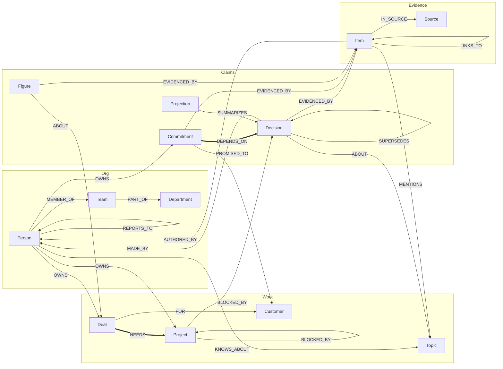
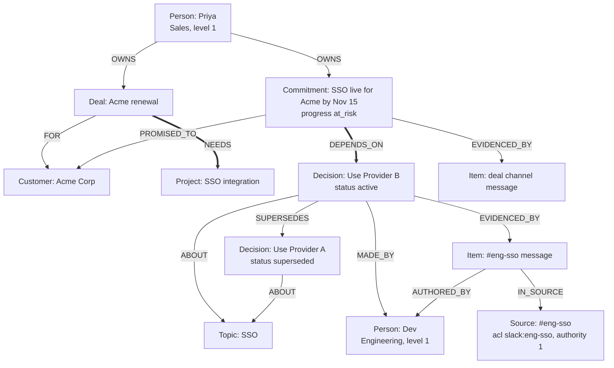

# Weave graph data model (FalkorDB)

This is the contract for the FalkorDB graphs that hold Weave's company knowledge. The code version is [`shared/schema.py`](../shared/schema.py), and queries import labels, edge types, and properties from it instead of spelling them by hand. [`shared/validate.py`](../shared/validate.py) checks a graph against these rules. [`shared/indexes.py`](../shared/indexes.py) creates the indexes.

## Graphs

| Graph | Name | Holds | Who writes it |
| --- | --- | --- | --- |
| Company graph | `co:{tenant}` | People, org units, work, claims, evidence, and projections for one company | Only the ingestion pipeline |
| Private graph | `u:{tenant}:{user}` | One person's personal items and the agent's semantic memory about them | The memory consolidation job, for that user only |

Each tenant has its own graph name, so a query against `co:acme` can never see `co:real`. Agents open the company graph read-only and query it with `ro_query`. A test enumerates every registered tool and fails if any of them can write to the graph.

Every node carries `tenant_id`, and every id starts with `{tenant}:`.

## Overview

The model has 13 contract node types in four families. Claims sit at the bottom: every claim points at the items that state it, and every item points at the source that owns its permissions.



The thick edges, `NEEDS` and `DEPENDS_ON`, are the bridges between Sales and Engineering.

## Labels

Each node has exactly one **contract label**, which is what agents query. Ingestion can add a **source-specific label** next to it:

| Contract label | Source-specific label | Example |
| --- | --- | --- |
| `Item` | `Message` | A Slack message or Gmail message |
| `Item` | `Document` | A Notion page or Drive file |
| `Item` | `Issue` | A GitHub issue or PR |
| `Source` | `Conversation` | A Slack channel |
| `Source` | `Repository` | A GitHub repo |
| `Source` | `Teamspace` | A Notion teamspace or Drive folder |

So a Slack message is `(:Message:Item)`, and a Slack channel is `(:Conversation:Source)`.

Ingestion also writes a few bookkeeping nodes that sit outside the contract and that agents never read: `Tenant`, `Connection`, and `GithubDelivery`, joined by `HAS_CONVERSATION` and `HAS_SOURCE`.

## Node types

**Req** means the property is required (`REQUIRED_PROPS`), and the validator rejects a node without it. Timestamps are UTC ISO-8601 strings at second precision, for example `2026-10-12T09:30:00+00:00`, so comparing them as strings matches time order. Date-only values are `YYYY-MM-DD`.

### Org

#### `Person`

An employee or contact. People are the subjects of ownership, expertise, authorship, and permissions.

| Property | Type | Req | Notes |
| --- | --- | --- | --- |
| `id` | string | ✓ | `{tenant}:person:{email}` (lowercased) |
| `tenant_id` | string | ✓ | |
| `name` | string | ✓ | |
| `email` | string | ✓ | Identity key across tools |
| `level` | int | ✓* | `0` intern, `1` individual contributor, `2` manager, `3` director |
| `dept` | string | ✓* | Department name, for example `Sales` or `Engineering` |
| `slack_id` | string | | Slack user id |
| `github_login` | string | | GitHub login |
| `notion_user` | string | | Notion user id |
| `provisional` | bool | | `true` until a second sighting confirms the person |

\* `level` and `dept` are required unless `provisional = true`.

#### `Team`, `Department`

Org units from the seeded org chart.

| Property | Type | Req | Notes |
| --- | --- | --- | --- |
| `id` | string | ✓ | `{tenant}:team:{slug}` or `{tenant}:department:{slug}` |
| `name` | string | ✓ | |
| `kind` | string | ✓ | For example `team` or `department` |

### Work

#### `Project`

A feature, epic, repo, or initiative.

| Property | Type | Req | Notes |
| --- | --- | --- | --- |
| `id` | string | ✓ | `{tenant}:project:{slug}` |
| `name` | string | ✓ | Full-text indexed |
| `status` | string | ✓ | Project state |
| `aliases` | list<string> | ✓ | Other names used in sources |

#### `Topic`

A technology, API, library, or concept, for example "SSO" or "OpenAI API key".

| Property | Type | Req | Notes |
| --- | --- | --- | --- |
| `id` | string | ✓ | `{tenant}:topic:{slug}` |
| `name` | string | ✓ | Full-text indexed |
| `aliases` | list<string> | ✓ | For example `["single sign-on"]` |

#### `Customer`

| Property | Type | Req | Notes |
| --- | --- | --- | --- |
| `id` | string | ✓ | `{tenant}:customer:{slug}` |
| `name` | string | ✓ | Full-text indexed |

#### `Deal`

| Property | Type | Req | Notes |
| --- | --- | --- | --- |
| `id` | string | ✓ | `{tenant}:deal:{slug}` |
| `name` | string | ✓ | |
| `stage` | string | ✓ | Sales stage |
| `renewal_date` | date | ✓ | `YYYY-MM-DD` |

### Claims

`Decision`, `Commitment`, and `Figure` are **claims**: facts extracted from sources. They share one lifecycle.

| Property | Type | Req | Notes |
| --- | --- | --- | --- |
| `id` | string | ✓ | `{tenant}:{label}:{sha256(first_evidence_item_id + normalized statement)[:16]}` |
| `status` | enum | ✓ | `active`, `superseded`, `retracted`. "Current" always means `status = 'active'`. |
| `valid_from` | timestamp | ✓ | When the claim became true |
| `valid_to` | timestamp | | Must be empty while active, and must be set once superseded |
| `confidence` | float | ✓ | Between 0 and 1. Answers mark low values as "likely". |
| `last_verified_at` | timestamp | ✓ | Moves forward when a newer item restates the claim |
| `extractor_version` | string | ✓ | Which extractor produced the claim, so it can be re-extracted |

Each claim type adds its own properties:

| Label | Extra properties (all required) | Meaning |
| --- | --- | --- |
| `Decision` | `statement` | A choice that was made, for example "Use Provider B for SSO." |
| `Commitment` | `statement`, `due` (date), `progress` (`open`, `at_risk`, `done`) | A promise with a date. Delivery state is `progress`, never `status`. |
| `Figure` | `name`, `value`, `unit`, `as_of` (timestamp) | A number about something, for example profit $2.4M as of Q3 |

**Rules for every claim:**
- It must have at least one `EVIDENCED_BY` edge. No evidence, no fact.
- A claim is visible only when at least one of its evidence items is visible to the caller.
- A reversal never overwrites anything. Ingestion writes the new claim, adds `(new)-[:SUPERSEDES]->(old)`, sets the old claim to `status = 'superseded'` and sets its `valid_to`, then emits a change event.

#### `Projection`

A sanitized summary of a claim, cascaded to a wider audience. This is how an intern learns about a management decision without seeing the leadership channel.

| Property | Type | Req | Notes |
| --- | --- | --- | --- |
| `id` | string | ✓ | `{tenant}:projection:{sha256(origin_id + sorted audience)[:16]}` |
| `summary` | string | ✓ | Two sentences, with confidential figures and names redacted |
| `audience` | list<acl group> | ✓ | Groups that may see it |
| `level_floor` | int | ✓ | `0` to `3`. The minimum caller level. |
| `origin_id` | string | ✓ | The claim it summarizes |
| `status` | enum | ✓ | `draft` or `approved`. Only `approved` is shown. |

A projection has exactly one `SUMMARIZES` edge, and it points at `origin_id`.

### Evidence

#### `Item`

One normalized source object: a Slack message, Gmail message, Notion page, Drive file, or GitHub issue or PR. Every citation points at an item.

| Property | Type | Req | Notes |
| --- | --- | --- | --- |
| `id` | string | ✓ | See [Ids](#ids) |
| `source` | string | ✓ | System: `slack`, `notion`, `gdrive`, `github`, `gmail`, `gcal`, `hubspot` |
| `external_id` | string | ✓ | The id in the source system |
| `object_type` | string | ✓ | `message`, `document`, `issue`, … |
| `occurred_at` | timestamp | ✓ | When it was written |
| `source_url` | string | ✓ | Deep link shown in citations |
| `content_hash` | string | ✓ | sha256 of the content. An unchanged hash skips re-processing. |
| `deleted` | bool | ✓ | Tombstone. Deleted items are never shown. |
| `acl_groups` | list<acl group> | ✓ | Who may see it, copied from its source |
| `min_level` | int | ✓ | `0` to `3`. Range indexed. |
| `excerpt` | string | | Text used as the citation snippet |
| `title` | string | | Page or issue title |
| `version` | string | | Source version. An older version never overwrites a newer one. |
| `edited_at` | timestamp | | Last edit at the source |
| `raw_id` | string | | Pointer to the untouched payload in Postgres |
| `placeholder` | bool | | `true` for a thread parent seen only through a reply |

Rules: an item has exactly one `IN_SOURCE` edge. When the author's email is known, it has exactly one `AUTHORED_BY` edge.

#### `Source`

A container that owns permissions: a Slack channel, GitHub repo, Notion teamspace, or Drive folder.

| Property | Type | Req | Notes |
| --- | --- | --- | --- |
| `id` | string | ✓ | For example `{tenant}:slack:conversation:{team}:{channel}` |
| `source` | string | ✓ | System |
| `external_id` | string | ✓ | |
| `name` | string | ✓ | Channel or repo name, shown in citations |
| `acl_groups` | list<acl group> | ✓ | |
| `min_level` | int | ✓ | `0` to `3` |
| `cascade_policy` | enum | ✓ | `broadcast` (projections are written automatically) or `manual` (a manager approves them) |
| `authority` | int | ✓ | `3` formal documents (Notion, Drive), `2` trackers (GitHub), `1` chat (Slack) |

## Edge types

The validator rejects any edge whose endpoints are not listed here (`EDGE_ENDPOINTS`).

### Org and expertise

| Edge | From | To | Properties | Use |
| --- | --- | --- | --- | --- |
| `MEMBER_OF` | Person | Team | | Org chart |
| `PART_OF` | Team | Department | | Org chart |
| `REPORTS_TO` | Person | Person | | Managers at level 2 and above inherit the groups of everyone below them |
| `OWNS` | Person | Project, Commitment, Topic, Deal, Customer | | Who owns what. Also used to decide who gets notified. |
| `KNOWS_ABOUT` | Person | Topic, Project | `score` (required) | Who knows what. The stored score covers all items, so `find_owner` rescores over visible items at query time. |

### Claims

| Edge | From | To | Properties | Use |
| --- | --- | --- | --- | --- |
| `ABOUT` | Decision, Figure | Topic, Project, Deal | | What the claim is about |
| `MADE_BY` | Decision | Person | | Who decided |
| `SUPERSEDES` | Decision, Figure, Commitment | Decision, Figure, Commitment | | The history chain. The target must be `superseded` with `valid_to` set, and a claim cannot supersede itself. |
| `EVIDENCED_BY` | Decision, Commitment, Figure | Item | `quote`, `span` `[start, end]`, `confidence` (all required) | Provenance for every fact |
| `SUMMARIZES` | Projection | Decision, Commitment, Figure | | Cascaded summary |

### Cross-department dependencies

Each of these edges must carry `evidence_ids`, a non-empty list of `Item` ids that justify the link. A walk counts an edge only when the caller can see at least one of those items.

| Edge | From | To | Use |
| --- | --- | --- | --- |
| `NEEDS` | Deal | Project | **Bridge**: Sales needs something Engineering builds |
| `DEPENDS_ON` | Commitment | Decision, Project, Commitment | **Bridge**: a promise rests on a decision or on other work |
| `BLOCKED_BY` | Project | Project, Decision | Delivery risk |

Two related edges have no evidence rule:

| Edge | From | To | Use |
| --- | --- | --- | --- |
| `FOR` | Deal | Customer | Who the deal is for |
| `PROMISED_TO` | Commitment | Customer | Who the promise was made to |

### Structure (from the rules step, confidence 1)

| Edge | From | To | Use |
| --- | --- | --- | --- |
| `IN_SOURCE` | Item | Source | Where an item lives and whose permissions apply. Exactly one per item. |
| `AUTHORED_BY` | Item | Person | Author |
| `MENTIONS` | Item | Person, Topic, Project, Customer | @mentions and named subjects |
| `LINKS_TO` | Item | Item | A URL from one item to another |
| `REPLIES_TO` | Item | Item | A thread reply to its parent |

## Ids

Ids are deterministic, so a retried write merges into the same node instead of creating a duplicate ([`shared/ids.py`](../shared/ids.py)).

| Node | Format | Example |
| --- | --- | --- |
| Person | `{tenant}:person:{email}` | `acme:person:priya@acme.com` |
| Entity | `{tenant}:{label}:{slug(name)}` | `acme:topic:sso` |
| Claim | `{tenant}:{label}:{sha256(evidence + statement)[:16]}` | `acme:decision:3f9a1c0e7b2d4a55` |
| Projection | `{tenant}:projection:{sha256(origin + audience)[:16]}` | |
| Slack message | `{tenant}:slack:message:{channel}:{ts}` | `real:slack:message:C0C90JZ4YMP:1791921228.170589` |
| Slack channel | `{tenant}:slack:conversation:{team}:{channel}` | `real:slack:conversation:T0C8H9PPXU7:C0C90JZ4YMP` |
| Notion or Drive doc | `{tenant}:{source}:document:{workspace}:{external_id}` | |
| GitHub issue | `{tenant}:github:issue:{repo}:{number}` | `real:github:issue:yuv008/portfolio:1` |
| Gmail message | `{tenant}:gmail:message:{mailbox}:{message_id}` | |

## Permissions in the graph

ACL groups are strings in the form `{system}:{container}` ([`shared/acl.py`](../shared/acl.py)):

| Group | Meaning |
| --- | --- |
| `slack:C0123ABC` | Members of a Slack channel |
| `github:org/repo` | People with access to a repo |
| `notion:{teamspace_or_page}` | Notion members |
| `gdrive:{folder_id}` | People a Drive folder is shared with |
| `org:all` | Everyone in the company |

A caller is a principal with a `level`, a set of `groups`, and the set of `fresh` source groups (sources whose last good ACL sync is within the cutoff). These travel to every query as `$gate_level`, `$gate_groups`, and `$gate_fresh`. Each tool builds its `WHERE` clause from [`agents/gate/visible.py`](../agents/gate/visible.py):

**Item rule.** The item is not deleted, its level is low enough, every one of its groups is fresh or org-wide, and at least one of its groups belongs to the caller:

```cypher
coalesce(i.deleted, false) = false
AND i.min_level <= $gate_level
AND all(g IN i.acl_groups WHERE g = 'org:all' OR g IN $gate_fresh)
AND any(g IN i.acl_groups WHERE g IN $gate_groups)
```

**Claim rule.** A claim is kept only if it has visible evidence. FalkorDB has no `EXISTS { }` subqueries and rejects pattern comprehensions inside `WHERE`, so the rule is a `WITH` step that binds the visible evidence and filters on its size:

```cypher
MATCH (d:Decision)-[:ABOUT]->(t:Topic {id: $topic})
WHERE d.status = 'active'
WITH d, [(d)-[:EVIDENCED_BY]->(i:Item) WHERE <item rule on i> | i] AS gate_evidence
WHERE size(gate_evidence) > 0
RETURN d, gate_evidence
```

**Edge rule.** A dependency edge is kept only if one of its `evidence_ids` items is visible:

```cypher
MATCH (a {id: nid})-[r:NEEDS|DEPENDS_ON|BLOCKED_BY]->(b)
OPTIONAL MATCH (gate_ei:Item)
WHERE gate_ei.id IN coalesce(r.evidence_ids, []) AND <item rule on gate_ei>
WITH a, b, r, collect(gate_ei) AS gate_edge_evidence
WHERE size(gate_edge_evidence) > 0
```

**Projection rule.** A projection is shown only when it is `approved`, the caller's level meets `level_floor`, and one of its `audience` groups belongs to the caller. The source is named as restricted: no quote and no link.

Because the filter runs inside the query, before ranking and `LIMIT`, hidden items are never returned, counted, or used for scoring.

## Indexes

[`shared/indexes.py`](../shared/indexes.py) creates them, and running it twice is safe.

| Kind | Label | Property |
| --- | --- | --- |
| Range | every contract label | `id` |
| Range | `Decision`, `Commitment`, `Figure`, `Projection` | `status` |
| Range | `Item` | `min_level` |
| Range | `Person` | `email` |
| Full-text (`db.idx.fulltext.createNodeIndex`) | `Topic`, `Project`, `Customer` | `name`, used to match subjects in a question |
| Range (ingestion) | `Message`, `Document` | `id`, `tenant_id` |
| Range (ingestion) | `Issue`, `Tenant`, `Conversation`, `Connection`, `GithubDelivery` | `id` |

Vector search over text chunks runs in Postgres (`chunk` table, pgvector plus a generated `tsvector`). Each hit is then checked against its FalkorDB `Item` with the item rule above, so the graph decides what is shown.

## Writes

- **Only ingestion writes** `co:{tenant}`. Agents use `ro_query`.
- **`MERGE` on deterministic ids**, batched inside `UNWIND` (100 to 500 rows). A retry changes nothing.
- **Version check.** An update applies only when the incoming `version` is newer. An equal version re-merges edges without changing properties. An older version does nothing.
- **Tombstones.** An item deleted at its source gets `deleted = true`. A claim left with no evidence becomes `retracted`.
- **Change events** go to a Postgres outbox right after the graph write, keyed by fact id, and the impact watcher consumes them.

## Validator invariants

`python -m scripts.validate_graph` exports the graph and checks every rule below:

1. Each node has exactly one contract label, its id starts with `{tenant}:`, and no id is duplicated.
2. `tenant_id` matches the graph's tenant.
3. Required properties are present, and timestamps use the contract format.
4. Claims: `status` is one of `active`, `superseded`, `retracted`. `confidence` is between 0 and 1. An active claim has no `valid_to`.
5. Commitments: `progress` is one of `open`, `at_risk`, `done`.
6. Projections: `status` is `draft` or `approved`, `audience` holds valid ACL groups, and `level_floor` is between 0 and 3.
7. Items and sources: `acl_groups` are valid, and `min_level` is between 0 and 3. Sources also have a valid `cascade_policy`.
8. Non-provisional people have a `level` between 0 and 3 and a non-empty `dept`.
9. Every edge type is in the contract, and its endpoints are allowed.
10. Required edge properties are present: `EVIDENCED_BY` has `quote`, `span`, and `confidence`. `KNOWS_ABOUT` has `score`. Dependency edges have `evidence_ids`.
11. `evidence_ids` is a non-empty list of real `Item` ids.
12. Every claim has at least one `EVIDENCED_BY` edge.
13. Every item has exactly one `IN_SOURCE` edge, plus exactly one `AUTHORED_BY` edge when its author's email is known.
14. A projection's only `SUMMARIZES` target is its `origin_id`.
15. A `SUPERSEDES` target is `superseded`, has `valid_to` set, and is not the same node.

## Worked example: the SSO story

The Acme demo (`co:acme`) shows the whole model in one subgraph:



- **"Which SSO provider should I use?"** `get_decision` matches `Topic: SSO`, keeps the `active` decision with visible evidence, and returns Provider B. It cites `m1` and notes that Provider B replaced Provider A through `SUPERSEDES`.
- **"What breaks if we change SSO?"** `impact_of` walks `DEPENDS_ON` and `NEEDS` back from the decision to Priya's commitment and the Acme deal. It returns their owner through `OWNS`. Each hop is gated by the edge's `evidence_ids`.
- **Priya cannot see `#eng-sso`.** She still gets the decision through an approved `Projection` or the GitHub issue, but `m1` is never quoted to her.

## Example queries

Current decision on a topic, with only the evidence the caller may see:

```cypher
MATCH (d:Decision)-[:ABOUT]->(t:Topic {id: $topic})
WHERE d.status = 'active'
WITH d, [(d)-[e:EVIDENCED_BY]->(i:Item) WHERE <item rule on i> | i] AS gate_evidence
WHERE size(gate_evidence) > 0
RETURN d.statement, d.valid_from, gate_evidence
ORDER BY d.valid_from DESC LIMIT 1
```

The decision as it stood on a past date:

```cypher
MATCH (d:Decision)-[:ABOUT]->(t:Topic {id: $topic})
WHERE d.status <> 'retracted'
  AND d.valid_from <= $as_of
  AND (d.valid_to IS NULL OR d.valid_to > $as_of)
RETURN d
```

The history of a decision:

```cypher
MATCH path = (d:Decision {id: $id})-[:SUPERSEDES*0..]->(older:Decision)
RETURN [n IN nodes(path) | n.statement] AS history
```

Who owns a customer, through their deals:

```cypher
MATCH (p:Person)-[:OWNS]->(s {id: $subject}) RETURN p.name, p.dept
UNION
MATCH (p:Person)-[:OWNS]->(:Deal)-[:FOR]->(:Customer {id: $subject}) RETURN p.name, p.dept
```

Open cross-team dependencies per department:

```cypher
MATCH (p1:Person)-[:OWNS]->(a:Commitment)-[r:DEPENDS_ON]->(b)<-[:OWNS]-(p2:Person)
WHERE a.progress IN ['open', 'at_risk'] AND p1.dept <> p2.dept
RETURN p1.dept AS from_dept, p2.dept AS to_dept, count(*) AS open_dependencies
```

In the tools, every one of these also carries the gate's item and edge rules, and dependency walks expand one hop per query so each hop is filtered.
