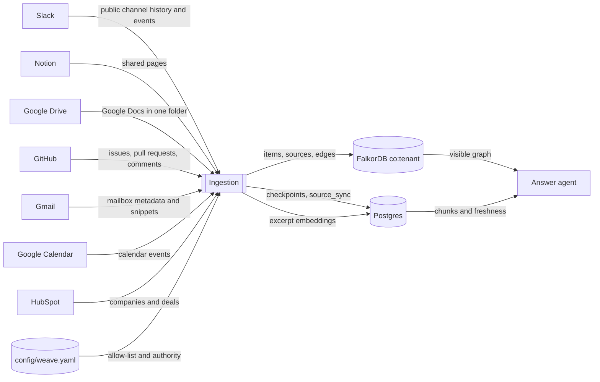
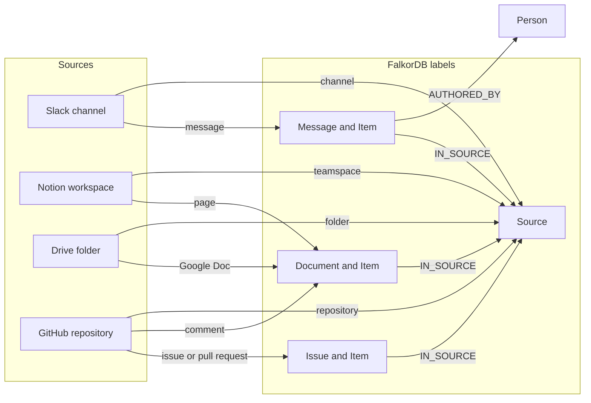

# Ingestion layer

**As of 16 October 2026.** This is the path a Slack message, Notion page, Google Doc, or GitHub issue takes from the provider API into FalkorDB and Postgres. Connector plans remain in the sibling files. Identifiers for the live sources stay in `config/weave.yaml` and `.env`.

## Latest findings

A kept live write now exists in graph `co:real`. The fixture graph `co:acme` was not modified. `WEAVE_TENANT` and `WEAVE_TENANT_ID` are both `real`. The yaml file still says `tenant: acme`, so agent commands that fall back to that file keep reading the fixture.

| Store | What the 16 October poll left there |
| --- | --- |
| FalkorDB `co:real` | 5 Slack messages (`Message` + `Item`), 5 portfolio pull requests (`Issue` + `Item`), 8 documents (`Document` + `Item`: issue comments, the Notion page, and the Drive doc), 2 channel sources, 1 repository source, 1 Drive source, 1 Notion teamspace, 4 connections, 2 people |
| Postgres `source_sync` | 5 rows, one per polled source, stamped when that page succeeded |
| Postgres `group_membership` | 5 rows for one viewer |
| Postgres `chunk` | 17 embedded excerpts. One stored item had an empty excerpt and has no chunk |
| Postgres `ingest_record` | Checkpoints, failures, and Slack event ids |

The polled sources are GitHub `yuv008/Weave`, the two public Slack channels `#social` and `#all-new-workspace`, the Notion workspace, and the shared Drive folder. All are org-wide.
- `yuv008/portfolio` was polled through the environment's `GITHUB_REPO` until the home company connected GitHub through the app with `Weave` chosen.
- The worker polls the environment settings only when no company holds a grant for that tool. So `portfolio` stopped there, and on 29 October 2026 it was taken out of config.
- The one-off Gmail, personal calendar, and HubSpot loads were taken out of config the same way. The worker never polled them.
- `python -m scripts.prune_source --tenant real --group <group> [--dry-run]` removes a source's stored data.
- GitHub items written by bots are not stored.

The viewer is Yuvraj Sanghai, level 1, department engineering. The person id is the mailbox in `WEAVE_VIEWER_EMAIL`, which is not committed. Slack `users.info` set that person's Slack id and display name, and moved `AUTHORED` and `AUTHORED_BY` onto that node. The other Slack author has a display name and no email, level, or department. GitHub returned no public email, so the old noreply person node was removed after the mailbox id was chosen.

An allow-listed source is the only thing that can advance a checkpoint. A successful page refreshes `source_sync`.

**Chunks.**
- When an upsert applies a new version, the item's full text is cut into chunks of about 1,200 characters at paragraph breaks, overlapping by 150. The text is capped at 100,000 characters.
- The chunks replace that item's old ones, with no embedding yet. Keyword search finds them at once, and the edge can ingest webhooks without the model.
- After each page, the worker embeds the company's chunks that have no vector (`BAAI/bge-small-en-v1.5`, 384 dimensions).
- A replayed version is not re-chunked, and an unchanged item is never re-embedded.
- A deleted item or an empty one has no chunks.
- The graph keeps only the 280-character excerpt.
- `python -m scripts.reread_sources --tenant <id>` makes the worker read a company's items again, which is how items stored before chunking got their full text.

`search_context` on `co:real`, in keyword mode, returned the Drive test doc and the Slack events message. `python -m scripts.ask --local` cited both. No Acme fixture fact appeared.

Caller-supplied claims live beside this layer: `POST /claims/commitment`, `POST /claims/figure`, and `POST /claims/supersede`. The quote has to occur in the stored excerpt of any item. The same evidence and statement merge. Supersede sets the old claim to `superseded`, sets `valid_to`, and inserts one `change_event` row whose id is `{fact_id}:superseded`. None of those routes has been called against `co:real`.

Still outside this layer: projections, merging people other than the viewer, embedding from a single Slack event or GitHub webhook, and full message or document bodies.

## Context diagram

External systems sit outside the dashed line. The ingestion process reads the allow-list and writes two databases. Agents read those databases later. They do not write the company graph.



## Level 1 data flow

Each connector fetches one page, then the shared steps below run. A refused source never reaches Normalize.

```mermaid
flowchart TB
  api[Provider API]
  allow{Allow-list}
  norm[Normalize]
  merge[Versioned MERGE]
  ckpt[Write checkpoint]
  sync[Refresh source_sync]
  embed[Embed excerpts]
  graph[(FalkorDB)]
  records[(ingest_record)]
  freshness[(source_sync)]
  chunks[(chunk)]

  api -->|raw page| allow
  allow -->|container missing| stop[Return. No checkpoint]
  allow -->|listed source| norm
  norm -->|canonical record| merge
  merge -->|newer version| graph
  merge -->|same version| graph
  merge -->|older version| noop[No property change]
  merge -->|page accepted| ckpt
  ckpt --> records
  ckpt --> sync
  sync --> freshness
  graph -->|stored excerpt| embed
  embed --> chunks
```

### Processes

| Step | What it does | Where it stops |
| --- | --- | --- |
| 1 Fetch | Slack lists public channels and history. Notion searches shared pages. Drive lists Docs in one folder. GitHub lists issues and pull requests, then comments. Gmail lists mailbox messages or `users.history`. Google Calendar lists events with a `syncToken`. HubSpot searches companies and deals by `hs_lastmodifieddate`. | Provider error. The page is not marked complete. |
| 2 Allow-list | Looks up `slack:{channel}`, `notion:{workspace}`, `gdrive:{folder}`, `github:{owner/repo}`, `gmail:{mailbox}`, `gcal:{calendar}`, or `hubspot:{portal}` in `config/weave.yaml`. | Missing key. The function returns before `ingest_record` is updated. |
| 3 Normalize | Builds one canonical message or document. Keeps a SHA-256 hash, a 280-character excerpt, the source URL, and the full text in a `body` field that is never serialized or written to the graph. | Malformed record. A failure row is stored and the page does not advance. |
| 4 Versioned MERGE | FalkorDB `MERGE` on the stable id. A newer version replaces the excerpt and hash. The same version refreshes edges only. An older version writes nothing. A delete blanks the excerpt and keeps the edges. | The node id is the duplicate key. |
| 5 Checkpoint | After every record on the page is accepted, write `ingest_record` kind `sync_state`. | A blocked record returns first, so the cursor stays put. |
| 6 Source sync | On that same success, upsert `source_sync.last_good_sync_at` for the source. The gate hides an item whose group is older than 15 minutes. | Memory stores used by tests do not touch Postgres. |
| 7 Chunk and embed | An applied new version replaces the item's chunks from its full text, copying `acl_groups` and `min_level`. The worker embeds pending chunks after each page. | A memory store skips the model. A delete or empty text removes the item's chunks. |

### What each connector writes



Slack also keeps the older `CONTAINS`, `AUTHORED`, and `REPLIES_TO` edges beside the contract edges. A reply that arrives before its parent creates a placeholder. The parent fill replaces that placeholder when the parent version arrives.

## Stores

| Store | Table or graph | Written by the poll | Read by |
| --- | --- | --- | --- |
| Company graph | FalkorDB `co:{WEAVE_TENANT}` | Yes. `acme` is refused by `connect_graph` | Graph tools |
| Checkpoints | Postgres `ingest_record` | Yes | The next poll |
| Freshness | Postgres `source_sync` | Yes, after a successful page | Permission gate |
| Search text | Postgres `chunk` | Yes, after a successful Postgres page | `search_context` |
| Who may read | Postgres `group_membership` | One-time insert for the viewer | Permission gate |
| Allow-list | `config/weave.yaml` | Edited by hand | Step 2 |

`search_context` never reads the excerpt on the graph node. It reads `chunk`, then checks the graph. A fresh `source_sync` row is required or the gate hides the item.

## One record, in order

1. The worker asks the provider for one page.
2. The container is compared with `config/weave.yaml`. A miss returns.
3. Each raw object becomes a canonical record with a stable id, version, hash, and excerpt.
4. `MERGE` applies the version rule and links `IN_SOURCE`. Slack also links `AUTHORED_BY`.
5. The checkpoint row moves only after the whole page is accepted.
6. `source_sync` for that source is set to now.
7. The same page embeds one `chunk` per non-empty excerpt when the store is Postgres.
